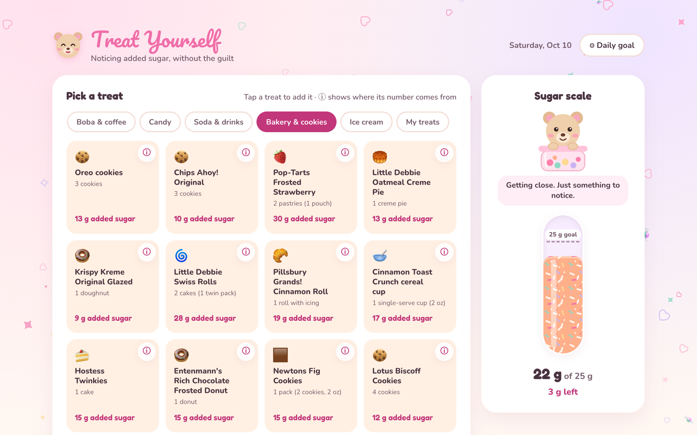

# 🍬 Treat Yourself

A cute, guilt-free added-sugar tracker. Answer two questions, get a personal daily added-sugar limit with its source, then tap treats to see how close you are. Honey the bear keeps you company, and nothing you enter leaves your browser.

Built as a small proof of concept for Devpost's **Build With AI: Basics** hackathon with the Devpost Learn skill pack, following its plan-first workflow (scope → PRD → spec → build). The planning documents are in [`devpost/`](devpost/): [`scope.md`](devpost/scope.md), [`prd.md`](devpost/prd.md), [`spec.md`](devpost/spec.md), the build [`checklist.md`](devpost/checklist.md), and a take-home [app map](https://rachelselbrede.github.io/sugar-tracker/devpost/app-map.html). [`skills-lock.json`](skills-lock.json) records which skill-pack versions were used.

**Try it:** https://rachelselbrede.github.io/sugar-tracker/ · **Code:** https://github.com/rachelselbrede/sugar-tracker



## Who it's for

Someone who is prediabetic, or isn't sure, and wants to notice how much added sugar they eat without a diet app that feels like calorie-shaming. Anyone can use it, but the default limits and the wording are tuned for them.

Why it matters: more than 2 in 5 American adults have prediabetes, which raises the risk of type 2 diabetes, heart disease, and stroke ([CDC](https://www.cdc.gov/diabetes/prevention-type-2/prediabetes-prevent-type-2.html)). US adults average about 17 teaspoons of added sugar a day, roughly 68 g at 4 g per teaspoon, and the leading sources are sugar-sweetened beverages, desserts, and sweet snacks ([CDC](https://www.cdc.gov/nutrition/php/data-research/added-sugars.html)). The American Heart Association's limit for women is 25 g. The app counts added sugar only, because that is what the public limits are written about, and because it's the sugar you can actually choose.

## What it does

- **A personal, sourced limit.** Pick your sex and whether you're prediabetic, and the app shows a recommended daily added-sugar limit, the reason, and a link to the guidance it came from.
- **70 sourced treats.** Every built-in treat shows its added sugar and serving. Tap **ⓘ** to see exactly where the number came from, with a link to the product's Nutrition Facts panel and the date it was checked.
- **Add your own.** Can't find it? Open **My treats** and type a treat's name and the "Includes Added Sugars" grams from your own label. It's marked as yours, and its ⓘ says plainly that the app hasn't checked it.
- **A kind sugar scale.** Tap a treat to log it. The scale fills toward your limit, and Honey reacts. Going over shows the number and a reminder that tomorrow is a fresh start. No red alerts, no guilt.
- **Remembers you.** Your profile, goal, your own treats, and today's log are saved in your browser. After midnight the log starts fresh; your profile stays.
- **Your own goal.** The **⚙︎ Daily goal** panel lets you set a custom number, use the 25 / 36 / 50 g quick buttons, go back to your recommended limit, or edit your profile.

## How it differs

- **The limit shows its work.** The sources are on the limit card, and the app says plainly that there is no official added-sugar number for prediabetes, so it uses the careful end of WHO and AHA guidance and labels it general guidance.
- **Every built-in treat cites its label.** ⓘ shows the serving, the "Includes Added Sugars" line it was read from, the store page, and the date it was checked. Treats whose labels don't list added sugar were left out, not guessed. Treats you add yourself live under My treats, are marked as yours, and are never shown as verified.
- **Added sugar only.** Total-sugar counts make fruit and milk count against you. The public limits are about added sugar, so that's what the scale measures.
- **Verified beats big.** 70 checked treats instead of a long guessed list. During research a crowdsourced database listed a Snickers bar at 0 g added sugar, which is why every number in the built-in list was read from a store's label page, and the second batch was re-read by an independent check before it went in (see `devpost/checklist.md > Revisions`).
- **Kind by design.** No red, no alarm copy. Going over states the number and that tomorrow is a fresh start.
- **Nothing leaves your browser.** Prediabetes status is health information. There is no account and no server.

## Run it

No build step and nothing to install. Serve the folder, then open the page:

```bash
python3 -m http.server 8000
```

Then visit http://localhost:8000. Opening `index.html` directly won't work, because browsers block JavaScript modules on `file://`.

## Test it

```bash
npm test
```

This uses Node's built-in test runner and installs nothing. The tests cover the limit table, the scale math, goal validation, the day key, safe storage, a check that every built-in treat has a positive added-sugar value, a serving, a valid basis, an https source, and a check date, plus validation and safe storage of treats you add yourself.

## How the numbers are chosen

**Daily limits** (added sugar per day):

| Profile | Limit | Source |
|---|---|---|
| Prediabetic, or not sure | 25 g, labeled as general guidance | There is no official added-sugar number for prediabetes. This uses the careful end of public guidance: the WHO's conditional target of under 5% of energy and the AHA's limit for women. |
| Not prediabetic, female | 25 g | American Heart Association |
| Not prediabetic, male | 36 g | American Heart Association |
| Not prediabetic, prefer not to say | 25 g | American Heart Association (the more careful limit) |

- AHA, *How much sugar is too much?*: https://www.heart.org/en/healthy-living/healthy-eating/eat-smart/sugar/how-much-sugar-is-too-much
- WHO, *Guideline: sugars intake for adults and children* (2015): https://www.who.int/news/item/04-03-2015-who-calls-on-countries-to-reduce-sugars-intake-among-adults-and-children
- The 50 g quick button is the FDA Daily Value for added sugars: https://www.fda.gov/food/nutrition-facts-label/added-sugars-nutrition-facts-label

**Treats.** A treat only goes on the built-in list if its added sugar is known, not guessed. Each value is the "Includes Xg Added Sugars" line from the product's US Nutrition Facts panel, read from a grocery-store product page that shows the full panel, for the serving shown. Items whose labels only give total sugar and contain milk, fruit, or juice were left out. The list and its source links live in [`js/treats.js`](js/treats.js), and the research notes are in [`devpost/sources.md`](devpost/sources.md). Treats you add under My treats come from your own label and are stored only in your browser.

Product names appear only to identify which Nutrition Facts panel a number came from. No logos or brand assets are used.

Treat Yourself is general guidance, not medical advice. Talk to your clinician about what's right for you.

## How it's built

Plain HTML, CSS, and JavaScript modules, with no framework and no dependencies.

- `index.html` — both screens (Profile and Tracker), the goal panel, the source popup, the add-your-own-treat form, and the footer
- `styles.css` — the pastel candy-shop look, layout, and reduced-motion fallback
- `js/app.js` — wires the page together: loads saved state, renders, handles taps, checks for a new day
- `js/logic.js` — the rules, as pure functions: `recommendedLimit`, `scaleState`, `isValidGoal`, `todayKey`, `customTreatErrors`
- `js/storage.js` — safe localStorage reads and writes (`ty.profile`, `ty.goal`, `ty.log`, `ty.custom`) that never crash on blocked or corrupt data
- `js/treats.js` — the treat list with added sugar, serving, basis, and source link
- `js/honey.js` — Honey the bear, drawn as SVG in four moods
- `tests/` — the Node tests

## Honey and the original Treat Yourself

Honey the character comes from our earlier Treat Yourself project and was redrawn for this build; no earlier code was reused. The fonts (Fredoka, Nunito, Pacifico) and the pastel palette carry over as the design direction.

## License

MIT. See [LICENSE](LICENSE).
